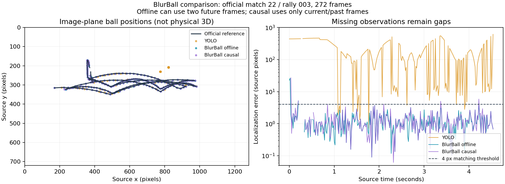

# BlurBall evaluation — 2026-10-09

**Decision: useful ball-detection challenger, empirically promising, not promoted to the application.** Its pretrained network substantially outperformed the deployed YOLO detector on one official labeled test clip. Causal inference is promising too. This does not establish venue/webcam accuracy or complete the advanced roadmap.

## What failed in the supplied footage

The screen recording `C:/Users/Adi/Videos/2026-10-09 11-49-46.mp4` was inspected as UI evidence, not passed into a detector or used for training. Original source clips were located through saved C++ manifests and logs.

| Original source | Native analyzed / decoded frames | Ball candidate frames | Frames with table corners | Physical speed / strikes |
|---|---:|---:|---:|---|
| `C:/Users/Adi/Downloads/001.mp4` | 193 / 193 | 112 | 1 | 0 / 0 |
| `C:/Users/Adi/Downloads/demo5.mp4` | 106 / 106 | 88 | 0 | 0 / 0 |

Both completed without a loading/decoding error. Both are 25 FPS files, despite the screen recording being 60 FPS. The selected model remained `yolov11_ttgames.engine`; importing BlurBall footage does not select BlurBall weights. Candidate counts are **not accuracy**. Without stable table geometry, pixel observations cannot justify physical speed, placements or 3D positions. Current tabletop refinement requires blue/green saturation (`scene_geometry.hpp`); table detection itself was also sparse.

The evaluator's YOLO accepted/missing decisions match every frame of these saved native runs. Selected scores differ by at most 0.00004961, consistent with four-decimal JSON serialization. This checks the diagnostic baseline, not the trajectory/event pipeline. Evidence: `artifacts/blurball_research/native_baseline_check.json`.

## Measured localization comparison

Downloaded official **match 22, rally 003**, listed as test footage in the published configuration. Sequential decode and zero-based CSV both contain 272 frames at 1280×720: 270 visible-ball references and only two absent-ball frames. Source SHA-256: `3597a95c664683d4b512c934b095bf51b45eda9112ebf377c960742e2146e011`.

Settings fixed before scoring: YOLO threshold 0.25; BlurBall pixel heatmap threshold 0.7, step-1 windows, previous-position gate strictly below 300 source pixels. Matching requires **distance <4 source pixels**, following the official tolerance. No label-based cropping or inference input was used.

| Detector / selection | Correct | Wrong location | Visible but missing | Absent false positives | Precision | Recall | Median position error* |
|---|---:|---:|---:|---:|---:|---:|---:|
| Deployed YOLO TensorRT, raw top proposal | 12 | 258 | 0 | 2 | 4.41% | 4.44% | 154.78 px |
| BlurBall, offline overlapping windows | 260 | 4 | 6 | 0 | 98.48% | 96.30% | 1.01 px |
| BlurBall, causal latest-frame output | 254 | 6 | 10 | 0 | 97.69% | 94.07% | 1.11 px |

\*All visible frames with a prediction, including wrong locations. Missing frames are reported separately. Full-recording causal recall includes two startup frames without three-frame context; after startup it is 94.78%. Upstream recall excludes misplaced visible predictions from its denominator. Here recall divides correct localizations by **all visible references**; the upstream convention is retained separately in JSON.

This is **one clip**, not a full benchmark. The config assigns match 22 to test, but the checkpoint does not embed its training manifest. Two negatives cannot satisfy absent-ball/furniture gates. No phone, webcam, blur-bin, natural-occlusion or uncertainty-calibration acceptance claim is made.

Evidence: `artifacts/blurball_research/official_22_003/metrics.json`, `download_manifest.json`, `comparison/predictions.jsonl`, and `comparison/comparison.avi`.



## User clip comparisons

| Clip | YOLO proposal frames | BlurBall offline | BlurBall causal |
|---|---:|---:|---:|
| `001.mp4` | 112 / 193 | 185 / 193 | 177 / 193 |
| `demo5.mp4` | 88 / 106 | 96 / 106 | 87 / 106 |

No matched independent labels were used for these clips. More proposals do not prove more correct detections; causal coverage on `demo5.mp4` is lower than YOLO. Visual comparisons are under `artifacts/blurball_research/{001,demo5}_comparison/`. All source frames, including trailing frames, are accounted for. No exact consecutive decoded duplicates were found; this does not rule out near-duplicates after compression. No frames were deleted or renumbered.

## Network and TensorRT feasibility

Three consecutive RGB frames form `[1,9,288,512]`; the output is three blur heatmaps `[1,3,288,512]`. The adapter follows dataset RGB affine preprocessing and ImageNet normalization. Weighted component centroids represent blur centers; PCA gives an **undirected** streak axis and extent.

The official `blurball_best` checkpoint loads with `weights_only=True` and exact state-dictionary matching. SHA-256: `3545206c7155194ea654899d33579c88c9fd8e82c632cbdbae3b0c0ec3f2985f`. Repository commit: `2f0f5496f7ba4b5b1a36790749935121b2ce972d`. Source/MIT notices are preserved in an ignored research checkout. Neither source nor weights were added to the desktop package.

ONNX checker and TensorRT 11.3 parsing/build passed. Strongly typed FP32, TF32 disabled, matched PyTorch on 18 real windows: 51 components matched, none unmatched; maximum logit error 0.0000391 and centroid difference 0.000209 source pixels. This is Python-driven TensorRT verification, **not native C++ integration**. Engine SHA-256: `48a3c3910b87552efd6cf2475fc70f1fd770db46d73fc30fe605b051d25faf0f`.

**Offline multi-pass GPU timing:** 18 passes on RTX 5050, TensorRT FP32 median 9.85 ms, p95 10.02 ms; PyTorch FP32 with TF32 disabled median 25.38 ms. Earlier inference runs used existing Torch defaults and measured approximately 18 ms. These exclude capture, preprocessing, postprocessing, scene inference, encoding, transport and rendering. This was not an exclusive-GPU benchmark. **Single-session live capture-to-display timing: unmeasured.** No 120 FPS claim is justified: 9.85 ms exceeds the 8.33 ms budget before other work. FP16 requires separate export/parity/accuracy checks.

Evidence: `artifacts/blurball_research/export/report.json`, `blurball_fp32.onnx`, `blurball_fp32.engine`.

## Integration path

1. Add an explicit experimental C++ ball-model backend; retain separate scene/person/table inference. Include engine hashes and preprocessing/selection policy in saved-analysis manifests, invalidating incompatible cached YOLO results.
2. Recordings can use overlapping windows with up to two future frames. Live uses only the latest output from `[t−2,t−1,t]`. Preserve source IDs/PTS, account for warmup and trailing frames, and evaluate these modes separately.
3. Feed pixel observations and streak evidence into the authoritative tracker/covariance/contact-aware gate. Component mass and heatmap peak must not become confidence percentages. Streak length cannot become km/h from FPS alone; actual exposure and geometry are needed.
4. Validate broader official test matches, OpenTTGames regressions, reviewed room/phone negatives and independent venue sessions. Report blur/occlusion subsets and uncertainty coverage. A bounded recovery policy needs its own evaluation; standalone precision is not accepted-recovery precision.
5. Fix table landmarks/pose separately. BlurBall does not detect players/tables, reconstruct physical 3D, validate strikes or estimate spin RPM. Better image trajectories are inputs to those systems, not proof they now work.

## Adapter safeguards and reproduction

The stock demo has BGR/RGB inconsistency, fixed 25 FPS export, incomplete trailing-frame handling at step 3, and misleading frame counters. Documented duplicate filtering is off by default. Its tracker uses removed `np.Inf`. The tools avoid that runner and do not replace the current CUDA/Python environment with old pinned dependencies.

Position selection follows step-1 component-mass ranking and the previous-position gate, with an added out-of-image center rejection. PCA orientation avoids the stock diagonal moment special-case; endpoints are inverse-transformed into source pixels. This is intentional adaptation, not exact blur-angle parity. Blur angle/length reference MAE remains unclaimed pending unit/convention checks.

From the project directory with the installed CUDA Python runtime:

```powershell
python python_tools/evaluate_blurball_candidate.py C:/Users/Adi/Downloads/001.mp4 artifacts/blurball_research/new_001_run
python python_tools/score_blurball_comparison.py artifacts/blurball_research/official_22_003/comparison/predictions.jsonl artifacts/blurball_research/official_22_003/labels.csv artifacts/blurball_research/official_22_003/new_metrics.json
python python_tools/export_blurball_candidate.py --output artifacts/blurball_research/new_export
python -m unittest discover -s python_tools -p test_blurball_comparison.py -v
```

Output directories must be new. Three geometry/tracking/scoring checks passed. The application, deployed weights and threshold remain unchanged. Original recordings/reviewed annotations were not rewritten or automatically relabeled.

## Primary sources

- [Official BlurBall repository and pretrained weights](https://github.com/cogsys-tuebingen/BlurBall)
- [Project and dataset description](https://cogsys-tuebingen.github.io/blurball/)
- [Model configuration](https://github.com/cogsys-tuebingen/blurball/blob/2f0f5496f7ba4b5b1a36790749935121b2ce972d/src/configs/model/blurball.yaml)
- [Inference runner](https://github.com/cogsys-tuebingen/blurball/blob/2f0f5496f7ba4b5b1a36790749935121b2ce972d/src/runners/inference.py)
- [Postprocessor](https://github.com/cogsys-tuebingen/blurball/blob/2f0f5496f7ba4b5b1a36790749935121b2ce972d/src/detectors/blurball_postprocessor.py)

The broader requirement ledger's unfinished gates remain authoritative. This evaluates a challenger; it does not complete the previous plan.
